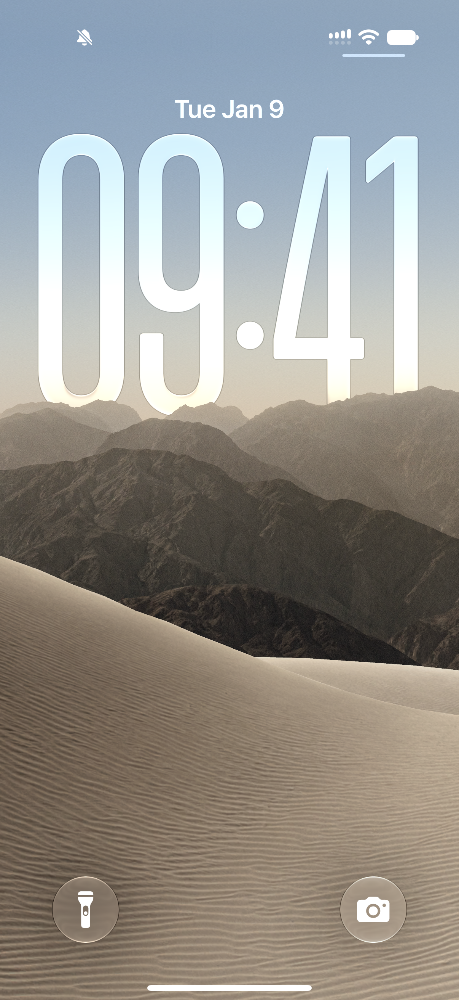
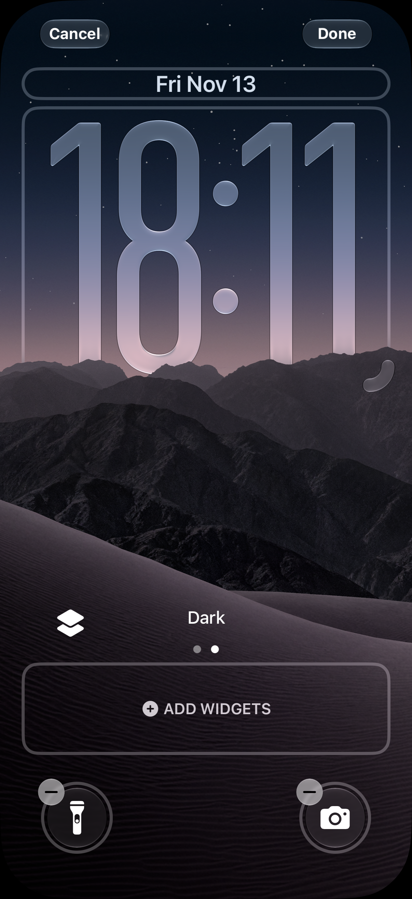

# iPhone Duo wallpapers

**Light Dunes** and **Dark Dunes**, rendered by Apple's native Mercury wallpaper engine.

[Download the wallpapers](wallpapers/iPhone%20Duo.tendies?raw=true)

Tested on **iPhone 17 Pro · iOS 27.3 beta 1**.

  
  

## Apply

1. Import the `.tendies` file into [GestaltX 1.0.7+](https://github.com/huamidev/GestaltX) or [Worse Poster](https://github.com/nxtcoreee3/Worse-Poster).
2. Apply the pack and follow the app's respring instructions, then choose a Duo wallpaper.

## Credits

- **Apple** — original wallpapers and Mercury renderer.
- **[pdfux / @itspdfu](https://gist.github.com/pdfux/da1ca51123c59239a9712e5af9372191)** — descriptor research and configuration method.
- **[Nugget-Wallpapers contributors](https://github.com/SerStars/Nugget-Wallpapers/blob/f196a3a93645bbc3bfb7b95a3081817a4813aba0/wallpapers/apple/iPhone%2018%20Pro.tendies)** — iPhone 18 Pro configuration template.

Adapted for iPhone Duo on November 13, 2026. [GPL-3.0 license](LICENSE).
